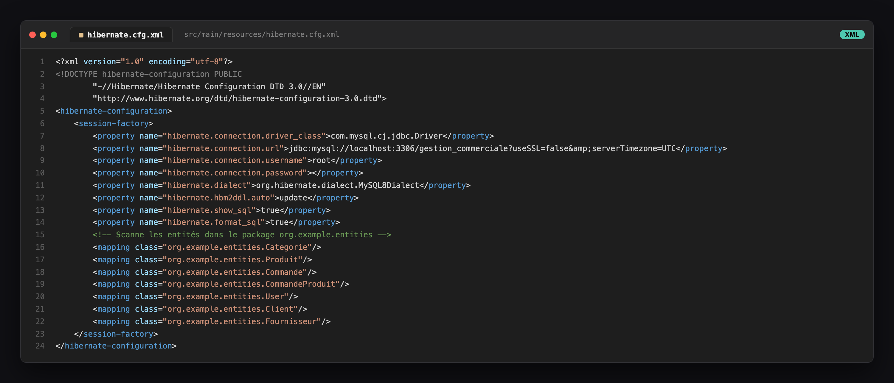
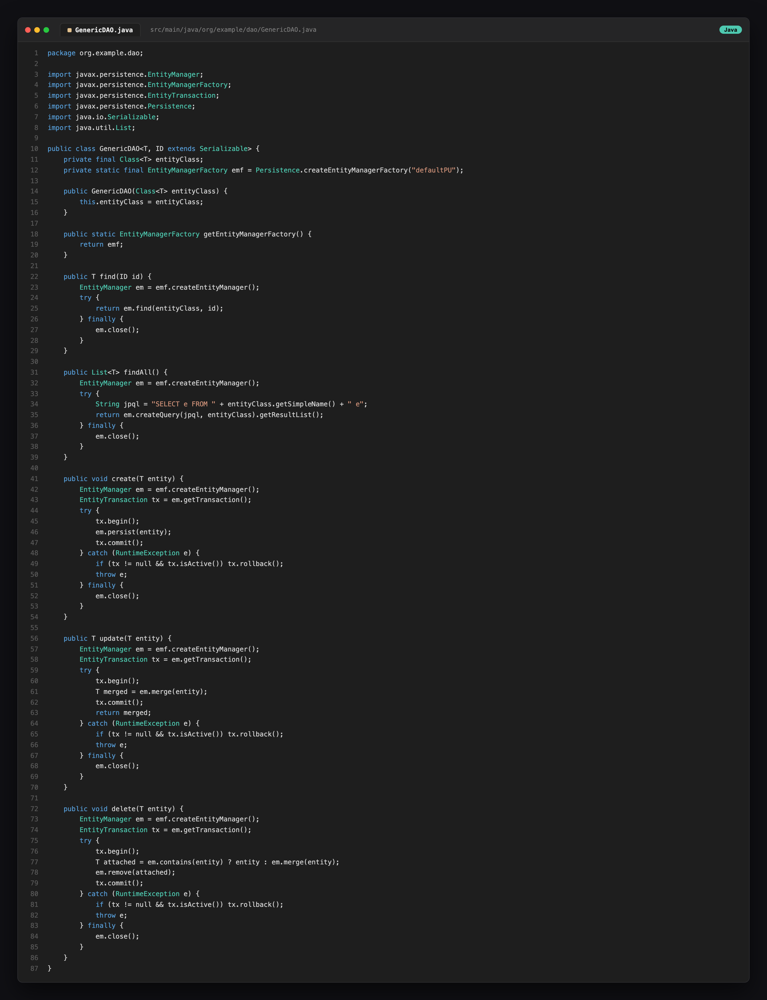
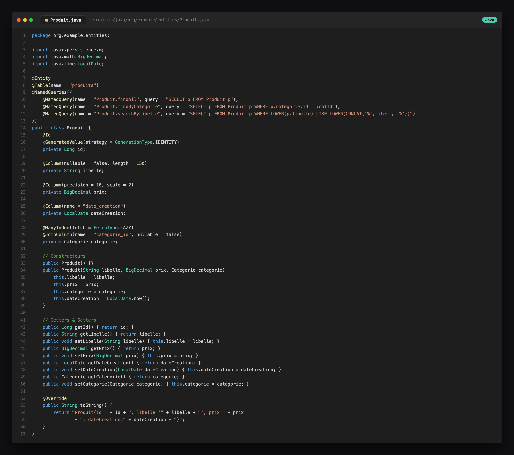
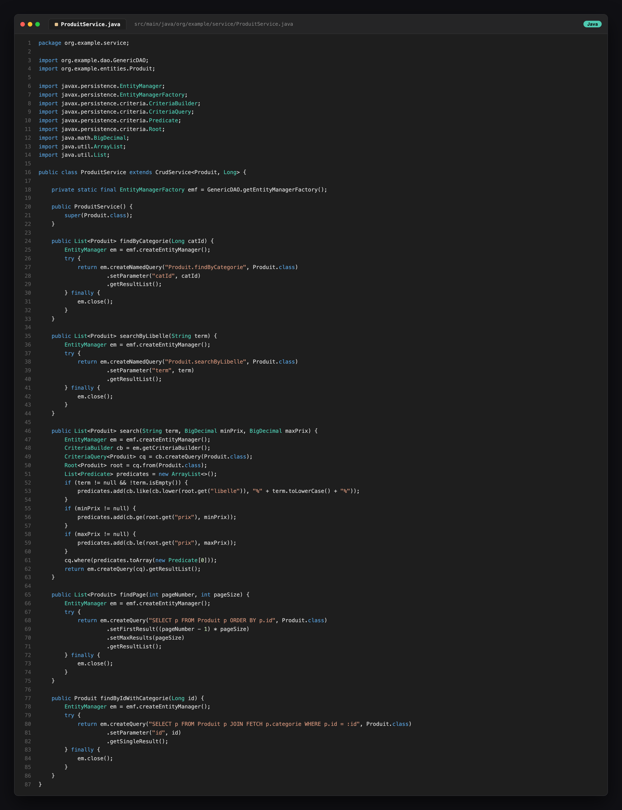
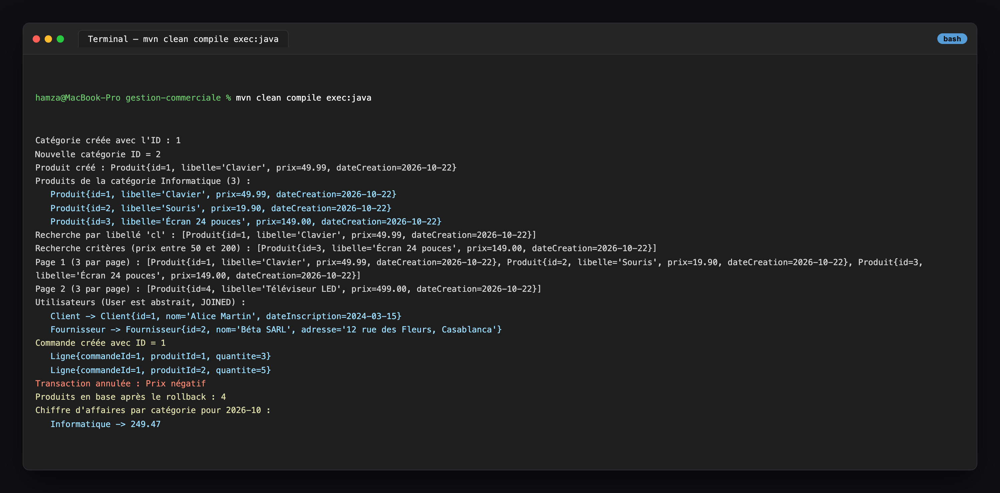

# TP Révision — Gestion commerciale avec Hibernate & JPA

## 1. Configuration Hibernate (hibernate.cfg.xml, MySQL 8)

## 2. GenericDAO — sessions, transactions et EntityManager fermés

## 3. Entité Produit — relation ManyToOne et Named Queries

## 4. Service Produit — JPQL, Criteria API et pagination

## 5. Exécution — DAO, requêtes, héritage JOINED, N:N et rapport

